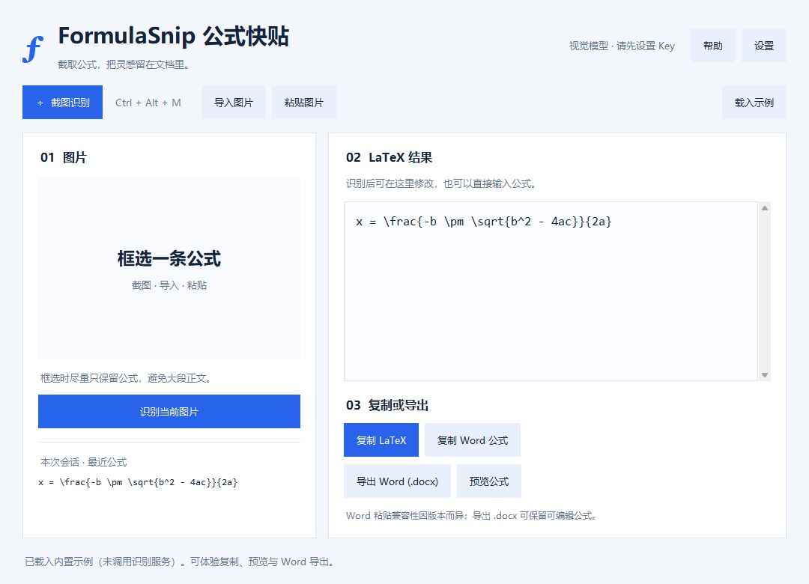
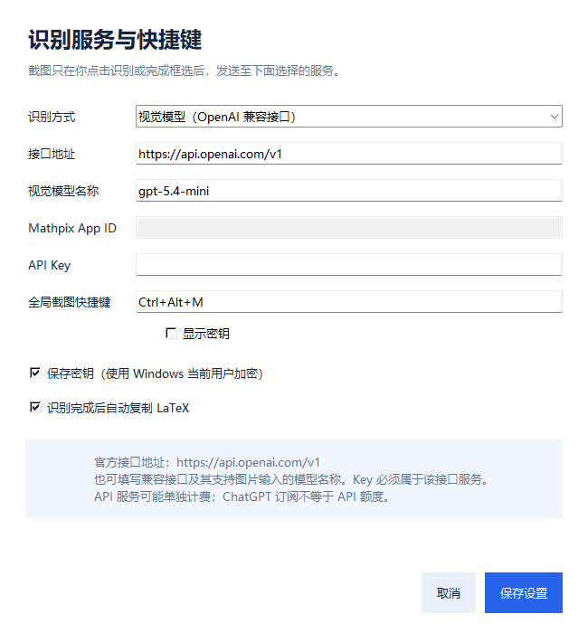

# FormulaSnip 公式快贴

快捷键截图识别数学公式，转换为 LaTeX 或可编辑 Word 公式的 Windows 桌面工具。

FormulaSnip 适合在阅读论文、整理笔记和编写报告时转写公式。按下快捷键，框选屏幕中的公式，即可调用自己配置的云端识别服务获取 LaTeX；核对或修改后，可复制代码、复制 Word 公式，或导出包含原生公式的 `.docx` 文档。

> 公式识别需要用户自己的 API Key。软件不附带识别额度，云端服务可能收费。当前版本不提供离线公式 OCR。



## 功能

- **快捷键截图**：默认 `Ctrl+Alt+M`，拖动框选后自动识别；`Esc` 或右键取消。
- **多种图片来源**：截图、导入本地图片或粘贴剪贴板图片。
- **可选识别服务**：Mathpix，或支持图片输入及 Chat Completions 请求格式的 OpenAI 兼容接口。
- **可编辑 LaTeX**：识别结果可以直接修改，也支持手动输入公式。
- **Word 原生公式**：提供公式剪贴板格式及 `.docx` 导出，导出的公式可继续编辑。
- **离线公式预览**：将已有 LaTeX 本地转换为 MathML，在默认浏览器显示。
- **会话历史**：保留本次运行最近 12 条公式。
- **密钥加密保存**：可选使用 Windows 当前用户的 DPAPI 加密保存 API Key。

## 下载与使用

前往本仓库右侧的 **Releases**，下载 `FormulaSnip-1.0.0-Windows-x64.zip`，完整解压后双击 `FormulaSnip.exe`。便携版无需安装 Python。

运行环境：Windows 10 / 11，64 位。当前开发验证环境为 Windows 11。

### 第一次配置

点击“设置”，选择识别服务：

| 服务 | 需要填写 |
| --- | --- |
| Mathpix | App ID，以及填入“API Key”框的 App Key |
| OpenAI 兼容视觉接口 | API 地址、支持图片输入的模型名，以及该服务的 API Key |

OpenAI 官方 API 地址为 `https://api.openai.com/v1`。默认模型名称以代码和设置界面为准，也可以改为自己账号已开通的视觉模型。使用其他兼容服务时，请按该服务文档填写地址和模型，API Key 必须与服务匹配。

ChatGPT 订阅与 API 额度分开；识别可用性、费用及模型权限以所选服务为准。



### 截图识别

1. 保存服务设置。
2. 按 `Ctrl+Alt+M`，拖动鼠标框选公式。
3. 松开鼠标后自动识别，结果显示在右侧。
4. 核对上下标、括号、希腊字母等细节，需要时直接编辑。
5. 点击“复制 LaTeX”“复制 Word 公式”或“导出 Word (.docx)”。

导入或粘贴图片后，点击“识别当前图片”，也可按 `Ctrl+Enter`。最小化窗口后快捷键仍可用；关闭窗口即退出。

没有 Key 时，可点击“载入示例”体验复制、预览及 Word 导出，该操作不会请求识别服务。

### 放入 Word

- **直接粘贴**：点击“复制 Word 公式”，在 Word 正文按 `Ctrl+V`。
- **导出文档**：如果粘贴显示源码、空白或排版异常，使用“导出 Word (.docx)”。打开文档后，可编辑其中的原生公式，或复制到其他文档。
- **LaTeX 输入**：支持此功能的 Word 中，按 `Alt+=` 插入公式，切换为 LaTeX 输入后粘贴代码，再转换为专业格式。

## 从源码运行

需要 Windows 和 Python 3.12。以下命令在仓库根目录的 PowerShell 中执行，无需激活虚拟环境：

```powershell
python -m venv .venv
.\.venv\Scripts\python.exe -m pip install -r requirements.txt
.\.venv\Scripts\python.exe app.py
```

主要依赖：Pillow、latex2mathml、mathml2omml；桌面界面使用 Tkinter，系统功能使用 Win32 API。

## 测试

```powershell
.\.venv\Scripts\python.exe -m unittest discover -s . -p "test_*.py" -v
```

现有测试覆盖配置与密钥加密、模拟识别请求、异步结果处理、截图裁切、快捷键及公式转换。测试使用本地模拟服务和假凭据，不调用真实收费识别接口。

开发环境最近一次结果：**70 项测试中 69 项通过，1 项实际剪贴板写入测试跳过**。运行测试需要正常 Windows 桌面环境和本机网络权限；剪贴板写入测试默认不执行。已打包程序另行检查了启动、截图尺寸、全局快捷键、加密及 `.docx` 导出。

## 构建便携版

在 PowerShell 中运行 `build.ps1`，或执行：

```powershell
.\.venv\Scripts\python.exe -m pip install pyinstaller==6.22.3
.\.venv\Scripts\python.exe -m PyInstaller --noconfirm --clean --onefile --windowed --name FormulaSnip --collect-data latex2mathml --exclude-module numpy --exclude-module matplotlib --exclude-module scipy --exclude-module pandas app.py
```

程序生成在 `dist/FormulaSnip.exe`。同时分发 `README.txt`、`使用说明.html`、两张界面预览图及 `第三方许可.txt`，便于用户查看帮助和依赖许可。

## 图片与设置

- 完成框选或主动识别时，只将选中区域或导入的图片发送到用户配置的接口，不上传整张桌面。
- 截图及公式历史只在内存保存，退出后清除；手动导出的文档由用户保留。
- 设置默认位于 `%LOCALAPPDATA%\FormulaSnip\settings.json`。
- 选择保存密钥时，使用当前 Windows 用户加密，不明文写入 Key；换电脑或账户后通常需要重新填写。
- 离线预览生成本地临时 HTML，正常退出时清理。

## 当前限制

- 识别准确性受图片质量、服务与模型影响，结果需要人工核对。
- 本项目尚未使用真实用户 Key 评估识别准确率，不宣称达到特定准确率或等同于 Mathpix 的识别效果。
- 常见分式、根式、上下标、求和、矩阵、分段及多行公式已进行转换检查；自定义宏、完整 LaTeX 文档及部分特殊排版可能无法导出。
- 已检查生成的 DOCX 结构并成功读取；开发环境未安装 Word，实际 Word 粘贴及视觉显示尚未实测。
- 不同“OpenAI 兼容”服务对参数的支持可能不同，需支持本程序发送的图片及 Chat Completions 请求格式。

## 反馈

欢迎通过本仓库的 Issues 提交问题。请附上 Windows 版本、服务类型、复现步骤及不含敏感内容的示例公式。不要提交 API Key、真实设置文件或含私人信息的截图。

## 许可证

项目许可证尚待维护者选择；本文件未宣称采用 MIT 或其他开源许可证。第三方依赖的许可见 [第三方许可.txt](第三方许可.txt)。选择项目许可证后，请同步更新此处及根目录 LICENSE 文件。

FormulaSnip 是独立工具，与 Mathpix 和 OpenAI 无隶属关系。相关服务名称仅用于说明兼容接口。
